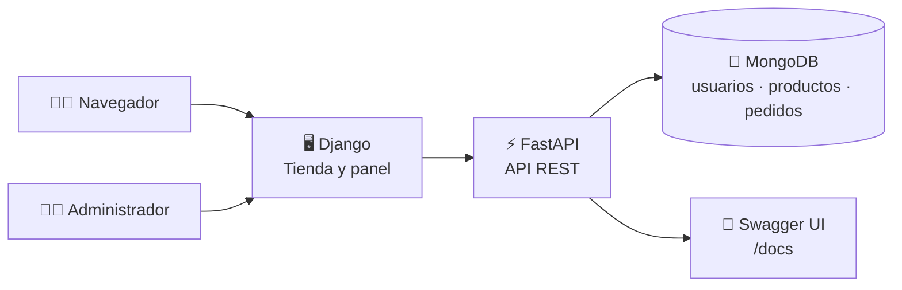

<div align="center">

# 🛒 TechGear

### Tienda de tecnología con API FastAPI y escaparate web Django

Explora el catálogo, crea pedidos, simula pagos y administra productos y envíos.
Los precios se presentan en pesos colombianos (COP).


</div>

> [!IMPORTANT]
> Los pagos disponibles (tarjeta, Nequi y transferencia) son **demostrativos**.
> No se procesa ningún pago real ni se almacenan datos financieros.

---

## 📚 Contenido

- [✨ Funcionalidades](#-funcionalidades)
- [🧰 Tecnologías](#-tecnologías)
- [🏗️ Arquitectura y estructura](#️-arquitectura-y-estructura)
- [✅ Requisitos previos](#-requisitos-previos)
- [🚀 Instalación y ejecución local](#-instalación-y-ejecución-local)
- [🔐 Variables de entorno](#-variables-de-entorno)
- [🛍️ Uso de la tienda](#️-uso-de-la-tienda)
- [📡 API REST](#-api-rest)
- [🧪 Pruebas y verificaciones](#-pruebas-y-verificaciones)
- [☁️ Despliegue](#️-despliegue)
- [🔒 Seguridad](#-seguridad)
- [📸 Capturas](#-capturas)
- [📄 Licencia](#-licencia)

## ✨ Funcionalidades

### 🛍️ Tienda

- Portada informativa con descripción de TechGear y enlaces de contacto de demostración.
- Catálogo en una ruta independiente (`/catalogo/`) con búsqueda por nombre, categoría y descripción.
- Catálogo de productos con imágenes, categoría, descripción y especificaciones.
- Registro e inicio de sesión para clientes; el administrador usa una cuenta fija y no requiere registro.
- Carrito acumulable asociado a la sesión del navegador, con contador Bootstrap, selección de productos para pagar, resumen dinámico, opción para quitar productos y total antes del checkout.
- Validación de stock al agregar productos y al procesar el pago.
- Controles para pedir deshabilitados cuando el stock llega a cero.
- El stock no se descuenta al agregar productos ni al crear un pedido pendiente; se descuenta al confirmar el pago.
- Seguimiento de pedidos por estado, desde pendientes de pago hasta enviados o recibidos.
- Seguimiento de pedidos pagados agrupados entre preparación, pendientes por recibir y recibidos.
- Precios y totales con formato de pesos colombianos y separador de miles.
- Enlace a la documentación interactiva de la API configurada para la tienda.
- Interfaz adaptable con modo claro y oscuro.
- Landing con imágenes optimizadas incluidas en los recursos estáticos del
  proyecto, para que no dependan de un servicio externo al cargar la página.
- Manejo de errores de conexión, timeout, respuestas inválidas de la API,
  errores de validación y solicitudes no autorizadas con mensajes claros.
- Páginas de error personalizadas para solicitudes incorrectas, acceso
  restringido, rutas inexistentes y errores internos (400, 403, 404 y 500).

### 🧑‍💼 Administración

- Publicar y eliminar productos desde el panel de tienda.
- Consultar pedidos agrupados por estado, incluidos los pendientes de pago, los que esperan envío y los enviados.
- Marcar pedidos pagados como enviados.
- Acceder sin crear una cuenta de administrador.
para el acceso solicitado; no son apropiadas para un despliegue público. Antes
de exponer la aplicación en producción, reemplaza este mecanismo por
credenciales seguras y configurables.

### 💳 Pagos de demostración

- Selección visual de tarjeta, Nequi o transferencia, sin conectar una pasarela ni solicitar credenciales o datos financieros.
- Captura de dirección, teléfono y código postal de seis dígitos para la entrega.
- La confirmación registra el pedido y su estado de pago de demostración en la API; no se realiza un cobro real ni se envían o almacenan datos financieros.
- El pedido pasa a preparación de envío después de confirmar el pago simulado.

## 🧰 Tecnologías

| Componente | Tecnología |
| --- | --- |
| API y reglas de negocio | Python, FastAPI, Pydantic |
| Sitio y plantillas | Django |
| Base de datos | MongoDB y PyMongo |
| Autenticación | JWT, OAuth2 Bearer y contraseñas con bcrypt |
| Recursos estáticos | WhiteNoise |
| Servidor local | Uvicorn |
| Despliegue | Render y Vercel |
| Pruebas web | Django test framework |

## 🏗️ Arquitectura y estructura

La aplicación FastAPI expone la API REST y monta la aplicación Django en la ruta
raíz. Django entrega la interfaz y usa un cliente HTTP para enviar las
operaciones de tienda a FastAPI. MongoDB almacena usuarios, productos y pedidos.



```text
.
├── api/
│   └── index.py                  # Entrada serverless de Vercel
├── techgear_api/
│   ├── app/
│   │   ├── core/                 # Configuración, MongoDB, seguridad y dependencias
│   │   ├── models/               # Esquemas Pydantic
│   │   ├── routers/              # Rutas de autenticación, usuarios, productos y pedidos
│   │   ├── services/             # Reglas de negocio y acceso a datos
│   │   └── main.py               # FastAPI y montaje de Django
│   ├── .env                      # Configuración local de FastAPI (crear; no subir)
│   └── requirements.txt          # Dependencias de la API
├── techgear_web/
│   ├── store/
│   │   ├── migrations/           # Migraciones Django
│   │   ├── static/store/         # CSS, imágenes del catálogo y landing
│   │   ├── templates/store/      # Portada, catálogo, acceso, pedidos y panel
│   │   ├── templatetags/         # Formato de moneda COP
│   │   ├── api_client.py         # Cliente HTTP para FastAPI
│   │   ├── tests.py              # Pruebas de rutas, catálogo, moneda y API
│   │   ├── urls.py               # Rutas web
│   │   └── views.py              # Catálogo, sesión, carrito, pagos y panel
│   ├── manage.py                 # Comandos de Django
│   ├── settings.py               # Configuración Django
│   └── requirements.txt          # Dependencias web
├── render.yaml                   # Servicio web de Render
├── requirements.txt              # Dependencias combinadas
├── vercel.json                   # Enrutamiento de Vercel
└── VERCEL.md                     # Guía adicional para Vercel
```

## ✅ Requisitos previos

- **Python 3** y `pip`.
- Una base de datos MongoDB accesible desde el entorno donde ejecutarás la app
  (por ejemplo, MongoDB Atlas).
- Git para clonar el repositorio.

## 🚀 Instalación y ejecución local

### 1. Clona el repositorio

```bash
git clone https://github.com/22CarlosNarvaez/FastAPI_t2.git
cd FastAPI_t2
```

### 2. Crea y activa un entorno virtual

Linux o macOS:

```bash
python3 -m venv .venv
source .venv/bin/activate
```

Windows PowerShell:

```powershell
py -m venv .venv
.\.venv\Scripts\Activate.ps1
```

### 3. Instala todas las dependencias

Desde la raíz del repositorio:

```bash
python -m pip install --upgrade pip
pip install -r requirements.txt
```

El archivo de dependencias de la raíz incluye FastAPI, Django, Uvicorn, PyMongo,
WhiteNoise y las demás dependencias necesarias para ejecutar el servicio
combinado.

### 4. Prepara MongoDB

Puedes usar MongoDB Atlas u otra instancia compatible:

1. Crea una base de datos y un usuario con permisos sobre ella.
2. Autoriza la conexión desde tu máquina en las reglas de acceso de red de
   MongoDB.
3. Copia la URI de conexión y reemplaza el marcador `TU_CLUSTER` en la
   configuración del siguiente paso.

La base de datos predeterminada se llama `techgear`; puedes cambiarla con
`DB_NAME`.

### 5. Configura las variables locales

FastAPI carga las variables de `techgear_api/.env`. Créalo a partir de este
ejemplo (no incluyas credenciales reales en Git):

```dotenv
MONGODB_URI=mongodb+srv://USUARIO:CLAVE@TU_CLUSTER/techgear?retryWrites=true&w=majority
SECRET_KEY=reemplaza-por-una-clave-larga-y-aleatoria
DB_NAME=techgear
```

Genera claves aleatorias únicas para tus entornos. Django, por su parte, lee su
configuración desde las variables del proceso; en Linux o macOS, expórtalas
antes de iniciar el servidor:

```bash
export DJANGO_SECRET_KEY='otra-clave-larga-y-aleatoria'
export DJANGO_DEBUG=true
```

En Windows PowerShell:

```powershell
$env:DJANGO_SECRET_KEY = "otra-clave-larga-y-aleatoria"
$env:DJANGO_DEBUG = "true"
```

`DJANGO_DEBUG=true` es únicamente para desarrollo local. En producción, déjalo
desactivado y configura las variables sensibles en el proveedor de despliegue.
Consulta [Variables de entorno](#-variables-de-entorno) para ver el listado.

### 6. Inicializa Django

Desde la raíz del repositorio:

```bash
python techgear_web/manage.py migrate
```

Este comando prepara las tablas que utiliza Django, incluida la administración
interna disponible en `/admin/`.

### 7. Inicia la aplicación

Desde la raíz del repositorio:

```bash
uvicorn app.main:app --app-dir techgear_api --reload
```

Abre estas direcciones en el navegador:

| Dirección | Contenido |
| --- | --- |
| <http://127.0.0.1:8000/> | Portada de la tienda |
| <http://127.0.0.1:8000/catalogo/> | Catálogo y productos disponibles |
| <http://127.0.0.1:8000/docs> | Documentación interactiva de FastAPI |
| <http://127.0.0.1:8000/openapi.json> | Esquema OpenAPI |
| <http://127.0.0.1:8000/health> | Estado de la API y conexión a MongoDB |
| <http://127.0.0.1:8000/panel/> | Panel de productos (requiere administrador) |
| <http://127.0.0.1:8000/pedidos/> | Pedidos del usuario o gestión administrativa |

Detén el servidor con `Ctrl+C`.

## 🔐 Variables de entorno

| Variable | Componente | Requerida | Descripción |
| --- | --- | :---: | --- |
| `MONGODB_URI` | FastAPI | Sí | URI de conexión a MongoDB. |
| `SECRET_KEY` | FastAPI | Sí | Secreto para firmar los tokens JWT. Debe ser único y privado. |
| `DB_NAME` | FastAPI | No | Base de datos MongoDB; predeterminada: `techgear`. |
| `ALGORITHM` | FastAPI | No | Algoritmo JWT; predeterminado: `HS256`. |
| `ACCESS_TOKEN_EXPIRE_MINUTES` | FastAPI | No | Duración del token en minutos; predeterminada: `60`. |
| `DJANGO_SECRET_KEY` | Django | En producción | Secreto de Django. Es obligatorio en Render y Vercel. |
| `DJANGO_DEBUG` | Django | No | Activa el modo de depuración cuando es `true`; no usar en producción. |
| `API_URL` | Django | No | URL base de FastAPI; fuera de Vercel se deriva de `PORT`, y en Vercel del dominio del despliegue si no se define explícitamente. El enlace **API** de la navegación abre `{API_URL}/docs`. |
| `PORT` | Django | No | Puerto usado para construir la URL de API predeterminada fuera de Vercel; en local, predeterminado: `8000`. |
| `DJANGO_ALLOWED_HOSTS` | Django | No | Hosts adicionales, separados por comas. |
| `DJANGO_CSRF_TRUSTED_ORIGINS` | Django | No | Orígenes CSRF adicionales, separados por comas e incluyendo esquema. |

En desarrollo, las variables FastAPI también pueden exportarse en la terminal en
lugar de guardarlas en `.env`. Django no lee automáticamente el archivo
`techgear_api/.env`; sus variables deben estar en el entorno del proceso.

## 🛍️ Uso de la tienda

1. Explora `/catalogo/`, selecciona las cantidades disponibles y agrega los
   productos al carrito. No necesitas iniciar sesión ni crear una cuenta para
   comprar; ambas opciones son voluntarias.
2. Abre `/pedidos/` para revisar el carrito y finalizar la compra. Indica dirección,
   celular y código postal, y elige tarjeta, Nequi o transferencia para
   confirmar el pedido de demostración. El carrito se conserva en la sesión
   mientras sigas usando el mismo navegador.
3. El inventario se descuenta únicamente cuando el pago se confirma. La API
   vuelve a validar la disponibilidad al procesar el pago y rechaza la
   operación si no hay existencias suficientes.
4. Consulta el seguimiento de tus pedidos en `/pedidos/`. Puedes iniciar sesión
   o crear una cuenta si deseas usar también las funciones de cliente.
5. Para administrar la tienda, inicia sesión con la cuenta fija
   `admin@gmail.com` / `1234567`. Usa `/panel/` para publicar o eliminar
   productos y `/pedidos/` para revisar pedidos por estado y marcarlos como
   enviados.

La ruta `/admin/` es independiente: corresponde al sitio administrativo
interno de Django y utiliza cuentas de Django, no la cuenta fija del panel de
TechGear.

## 📡 API REST

La API devuelve y recibe JSON, excepto el inicio de sesión, que sigue el formato
OAuth2 de formulario. Las rutas marcadas como protegidas requieren
`Authorization: Bearer <token>`.

### 🧭 Endpoints

| Método | Ruta | Acceso | Descripción |
| --- | --- | --- | --- |
| `GET` | `/health` | Público | Comprueba la API y la conexión a MongoDB. |
| `POST` | `/auth/login` | Público | Inicia sesión y entrega un token Bearer. |
| `POST` | `/usuarios/registro` | Público | Registra una cuenta de cliente; no permite registrar el administrador fijo. |
| `GET` | `/usuarios/me` | Autenticado | Devuelve el usuario de la sesión. |
| `GET` | `/usuarios` | Administrador | Lista los usuarios. |
| `PATCH` | `/usuarios/{usuario_id}/rol` | Administrador | Actualiza el rol de un usuario. |
| `GET` | `/productos` | Público | Lista el catálogo. |
| `GET` | `/productos/{producto_id}` | Público | Consulta un producto. |
| `POST` | `/productos` | Administrador | Crea un producto. |
| `PUT` | `/productos/{producto_id}` | Administrador | Actualiza un producto. |
| `DELETE` | `/productos/{producto_id}` | Administrador | Elimina un producto. |
| `POST` | `/pedidos` | Invitado (`X-Guest-ID`) o cliente autenticado | Crea un pedido pendiente y valida la disponibilidad, sin descontar stock. |
| `GET` | `/pedidos` | Invitado (`X-Guest-ID`) o autenticado | Invitado o cliente: sus pedidos. Administrador: todos. |
| `POST` | `/pedidos/{pedido_id}/pagar` | Invitado (`X-Guest-ID`) o cliente autenticado | Verifica y descuenta el stock y registra el pago simulado y los datos de entrega. |
| `PATCH` | `/pedidos/{pedido_id}/enviar` | Administrador | Marca un pedido pagado como enviado. |
| `PATCH` | `/pedidos/{pedido_id}/recibir` | Invitado (`X-Guest-ID`) o cliente autenticado | Confirma la recepción de un pedido propio. |

### 🔑 Ejemplos rápidos

Las rutas de pedidos para invitados reciben el identificador aleatorio de su
sesión mediante el encabezado `X-Guest-ID`. La tienda lo conserva en la sesión
del navegador para mostrar solo los pedidos de esa persona.

Inicio de sesión (el endpoint recibe formulario `username` y `password`):

```bash
curl -X POST http://127.0.0.1:8000/auth/login \
  -H "Content-Type: application/x-www-form-urlencoded" \
  -d "username=cliente@example.com&password=tu-clave"
```

Crear un pedido usando el token de acceso:

```bash
curl -X POST http://127.0.0.1:8000/pedidos \
  -H "Authorization: Bearer TU_TOKEN" \
  -H "Content-Type: application/json" \
  -d '{"items":[{"producto_id":"ID_DEL_PRODUCTO","cantidad":1}]}'
```

La forma más sencilla de explorar todos los esquemas y probar endpoints es
<http://127.0.0.1:8000/docs>.

## 🧪 Pruebas y verificaciones

Las pruebas Django actuales cubren rutas, llamadas y errores de la API,
presentación de productos agotados, validación de stock al agregar al carrito,
búsqueda, imágenes de la landing, precios colombianos, páginas de error y
gestión administrativa de pedidos. Para ejecutarlas desde la raíz:

```bash
python techgear_web/manage.py test store
```

Para validar la configuración de Django:

```bash
python techgear_web/manage.py check
```

Las pruebas de tienda simulan las respuestas de FastAPI; para usar la aplicación
completa localmente sí se necesita una instancia MongoDB configurada.

## ☁️ Despliegue

### 🚂 Render

El archivo [`render.yaml`](./render.yaml) define el servicio web, el comando de
instalación y arranque y el health check en `/health`.

1. Conecta el repositorio a Render y crea el servicio usando el Blueprint
   `render.yaml`.
2. Configura `MONGODB_URI`, `SECRET_KEY` y `DJANGO_SECRET_KEY` como variables
   privadas del servicio.
3. Despliega y comprueba que `/health` responda correctamente.

Render proporciona `RENDER_EXTERNAL_HOSTNAME`, que Django utiliza para
reconocer el host del servicio.

### ▲ Vercel

La configuración del repositorio está en la raíz y usa [`vercel.json`](./vercel.json)
para enrutar las solicitudes a la función FastAPI, que también monta Django.

1. Importa el repositorio en Vercel y conserva la raíz del repositorio como
   **Root Directory**.
2. Agrega `MONGODB_URI`, `SECRET_KEY` y `DJANGO_SECRET_KEY` en los entornos
   (Production y/o Preview) donde vas a desplegar.
3. Guarda las variables y vuelve a desplegar.

Vercel proporciona `VERCEL_URL`. En el despliegue combinado del repositorio,
Django puede usarlo para llegar a FastAPI; si la API se aloja en otro dominio,
configura `API_URL`. Para dominios propios, revisa
[`VERCEL.md`](./VERCEL.md) y configura `DJANGO_ALLOWED_HOSTS` y
`DJANGO_CSRF_TRUSTED_ORIGINS` cuando corresponda.

## 🔒 Seguridad

- No subas archivos `.env`, claves, tokens ni credenciales de MongoDB.
- Usa secretos largos, aleatorios, únicos y distintos por entorno.
- Configura las variables sensibles en el panel seguro del proveedor.
- Mantén `DJANGO_DEBUG` desactivado en producción.
- El administrador de TechGear usa credenciales fijas documentadas en este
  README. No publiques la aplicación con estas credenciales: cámbialas y
  adapta la autenticación antes de exponerla a usuarios externos.
- Las contraseñas se guardan con hash; las rutas protegidas de la API usan
  tokens Bearer.
- Los datos de pago del sitio son ficticios: no reemplazan una pasarela de pago.

## 📸 Capturas

<div align="center">


</div>

## 📄 Licencia

Este repositorio no especifica una licencia. Antes de reutilizarlo o
redistribuirlo, confirma los permisos con sus responsables.

---

<div align="center">

Hecho con 🐍 Python, ⚡ FastAPI, 🎸 Django y 🍃 MongoDB.

</div>
