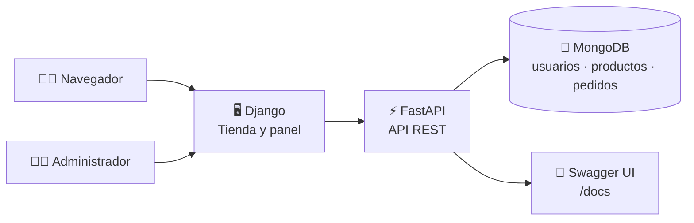

<div align="center">

# 🛒 TechGear

### Tienda de tecnología con API FastAPI y escaparate web Django

Explora el catálogo, crea pedidos, simula pagos y administra productos y envíos.
Los precios se presentan en pesos colombianos (COP).


</div>

> [!IMPORTANT]
> Los pagos disponibles (tarjeta, Nequi y transferencia) son **demostrativos**.
> No se procesa ningún pago real ni se almacenan datos financieros.

---

## 📚 Contenido

- [✨ Funcionalidades](#-funcionalidades)
- [🧰 Tecnologías](#-tecnologías)
- [🏗️ Arquitectura y estructura](#️-arquitectura-y-estructura)
- [✅ Requisitos previos](#-requisitos-previos)
- [🚀 Instalación y ejecución local](#-instalación-y-ejecución-local)
- [🔐 Variables de entorno](#-variables-de-entorno)
- [🛍️ Uso de la tienda](#️-uso-de-la-tienda)
- [📡 API REST](#-api-rest)
- [🧪 Pruebas y verificaciones](#-pruebas-y-verificaciones)
- [☁️ Despliegue](#️-despliegue)
- [🔒 Seguridad](#-seguridad)
- [📸 Capturas](#-capturas)
- [📄 Licencia](#-licencia)

## ✨ Funcionalidades

### 🛍️ Tienda

- Catálogo de productos con imágenes, categoría, descripción y especificaciones.
- Registro e inicio de sesión para clientes y administradores.
- Creación de pedidos desde el catálogo.
- Validación de stock al crear el pedido; las existencias se descuentan en la API
  y no se permite pedir más unidades de las disponibles.
- Controles de pedido deshabilitados cuando el producto está agotado.
- Seguimiento de pedidos pendientes, pagados, por enviar y enviados.
- Precios y totales con formato de pesos colombianos y separador de miles.

### 🧑‍💼 Administración

- Publicar y eliminar productos desde el panel de tienda.
- Consultar pedidos agrupados por estado.
- Marcar pedidos pagados como enviados.
- Crear una cuenta con rol de administrador usando el código de registro
  configurado en el servidor.

### 💳 Pagos de demostración

- Selección de tarjeta, Nequi o transferencia.
- El formulario utiliza valores ficticios y confirma que no se realizará un
  cobro real.
- El estado de envío se actualiza después de registrar el pago simulado.

## 🧰 Tecnologías

| Componente | Tecnología |
| --- | --- |
| API y reglas de negocio | Python, FastAPI, Pydantic |
| Sitio y plantillas | Django |
| Base de datos | MongoDB y PyMongo |
| Autenticación | JWT, OAuth2 Bearer y contraseñas con bcrypt |
| Recursos estáticos | WhiteNoise |
| Servidor local | Uvicorn |
| Despliegue | Render y Vercel |
| Pruebas web | Django test framework |

## 🏗️ Arquitectura y estructura

La aplicación FastAPI expone la API REST y monta la aplicación Django en la ruta
raíz. Django entrega la interfaz y usa un cliente HTTP para enviar las
operaciones de tienda a FastAPI. MongoDB almacena usuarios, productos y pedidos.



```text
.
├── api/
│   └── index.py                  # Entrada serverless de Vercel
├── techgear_api/
│   ├── app/
│   │   ├── core/                 # Configuración, MongoDB, seguridad y dependencias
│   │   ├── models/               # Esquemas Pydantic
│   │   ├── routers/              # Rutas de autenticación, usuarios, productos y pedidos
│   │   ├── services/             # Reglas de negocio y acceso a datos
│   │   └── main.py               # FastAPI y montaje de Django
│   ├── .env                      # Configuración local de FastAPI (crear; no subir)
│   └── requirements.txt          # Dependencias de la API
├── techgear_web/
│   ├── store/
│   │   ├── migrations/           # Migraciones Django
│   │   ├── static/store/         # CSS e imágenes de la tienda
│   │   ├── templates/store/      # Catálogo, acceso, pedidos y administración
│   │   ├── templatetags/         # Formato de moneda COP
│   │   ├── api_client.py         # Cliente HTTP para FastAPI
│   │   ├── tests.py              # Pruebas de rutas, catálogo y cliente API
│   │   ├── urls.py               # Rutas web
│   │   └── views.py              # Vistas de la tienda
│   ├── manage.py                 # Comandos de Django
│   ├── settings.py               # Configuración Django
│   └── requirements.txt          # Dependencias web
├── render.yaml                   # Servicio web de Render
├── requirements.txt              # Dependencias combinadas
├── vercel.json                   # Enrutamiento de Vercel
└── VERCEL.md                     # Guía adicional para Vercel
```

## ✅ Requisitos previos

- **Python 3** y `pip`.
- Una base de datos MongoDB accesible desde el entorno donde ejecutarás la app
  (por ejemplo, MongoDB Atlas).
- Git para clonar el repositorio.

## 🚀 Instalación y ejecución local

### 1. Clona el repositorio

```bash
git clone https://github.com/22CarlosNarvaez/FastAPI_t2.git
cd FastAPI_t2
```

### 2. Crea y activa un entorno virtual

Linux o macOS:

```bash
python3 -m venv .venv
source .venv/bin/activate
```

Windows PowerShell:

```powershell
py -m venv .venv
.\.venv\Scripts\Activate.ps1
```

### 3. Instala todas las dependencias

Desde la raíz del repositorio:

```bash
python -m pip install --upgrade pip
pip install -r requirements.txt
```

El archivo de dependencias de la raíz incluye FastAPI, Django, Uvicorn, PyMongo,
WhiteNoise y las demás dependencias necesarias para ejecutar el servicio
combinado.

### 4. Prepara MongoDB

Puedes usar MongoDB Atlas u otra instancia compatible:

1. Crea una base de datos y un usuario con permisos sobre ella.
2. Autoriza la conexión desde tu máquina en las reglas de acceso de red de
   MongoDB.
3. Copia la URI de conexión y reemplaza el marcador
   `tu_uri_de_mongodb` en la configuración del siguiente paso.

La base de datos predeterminada se llama `techgear`; puedes cambiarla con
`DB_NAME`.

### 5. Configura las variables locales

FastAPI carga las variables de `techgear_api/.env`. Créalo a partir de este
ejemplo (no incluyas credenciales reales en Git):

```dotenv
MONGODB_URI=mongodb+srv://USUARIO:CLAVE@TU_CLUSTER/techgear?retryWrites=true&w=majority
SECRET_KEY=reemplaza-por-una-clave-larga-y-aleatoria
DB_NAME=techgear
ADMIN_REGISTRATION_CODE=codigo-local-de-administrador
```

Genera claves aleatorias únicas para tus entornos. Django, por su parte, lee su
configuración desde las variables del proceso; en Linux o macOS, expórtalas
antes de iniciar el servidor:

```bash
export DJANGO_SECRET_KEY='otra-clave-larga-y-aleatoria'
export DJANGO_DEBUG=true
```

En Windows PowerShell:

```powershell
$env:DJANGO_SECRET_KEY = "otra-clave-larga-y-aleatoria"
$env:DJANGO_DEBUG = "true"
```

`DJANGO_DEBUG=true` es únicamente para desarrollo local. En producción, déjalo
desactivado y configura las variables sensibles en el proveedor de despliegue.
Consulta [Variables de entorno](#-variables-de-entorno) para ver el listado.

### 6. Inicializa Django

Desde la raíz del repositorio:

```bash
python techgear_web/manage.py migrate
```

Este comando prepara las tablas que utiliza Django, incluida la administración
interna disponible en `/admin/`.

### 7. Inicia la aplicación

Desde la raíz del repositorio:

```bash
uvicorn app.main:app --app-dir techgear_api --reload
```

Abre estas direcciones en el navegador:

| Dirección | Contenido |
| --- | --- |
| <http://127.0.0.1:8000/> | Catálogo de la tienda |
| <http://127.0.0.1:8000/docs> | Documentación interactiva de FastAPI |
| <http://127.0.0.1:8000/openapi.json> | Esquema OpenAPI |
| <http://127.0.0.1:8000/health> | Estado de la API y conexión a MongoDB |
| <http://127.0.0.1:8000/panel/> | Panel de productos (requiere administrador) |
| <http://127.0.0.1:8000/pedidos/> | Pedidos del usuario o gestión administrativa |

Detén el servidor con `Ctrl+C`.

## 🔐 Variables de entorno

| Variable | Componente | Requerida | Descripción |
| --- | --- | :---: | --- |
| `MONGODB_URI` | FastAPI | Sí | URI de conexión a MongoDB. |
| `SECRET_KEY` | FastAPI | Sí | Secreto para firmar los tokens JWT. Debe ser único y privado. |
| `DB_NAME` | FastAPI | No | Base de datos MongoDB; predeterminada: `techgear`. |
| `ALGORITHM` | FastAPI | No | Algoritmo JWT; predeterminado: `HS256`. |
| `ACCESS_TOKEN_EXPIRE_MINUTES` | FastAPI | No | Duración del token en minutos; predeterminada: `60`. |
| `ADMIN_REGISTRATION_CODE` | FastAPI | Recomendado | Código requerido para registrar cuentas con rol `admin`. |
| `DJANGO_SECRET_KEY` | Django | En producción | Secreto de Django. Es obligatorio en Render y Vercel. |
| `DJANGO_DEBUG` | Django | No | Activa el modo de depuración cuando es `true`; no usar en producción. |
| `API_URL` | Django | No | URL base de FastAPI si no comparte el dominio actual. |
| `PORT` | Django | No | Puerto local usado para construir la URL de API predeterminada. |
| `DJANGO_ALLOWED_HOSTS` | Django | No | Hosts adicionales, separados por comas. |
| `DJANGO_CSRF_TRUSTED_ORIGINS` | Django | No | Orígenes CSRF adicionales, separados por comas e incluyendo esquema. |

En desarrollo, las variables FastAPI también pueden exportarse en la terminal en
lugar de guardarlas en `.env`. Django no lee automáticamente el archivo
`techgear_api/.env`; sus variables deben estar en el entorno del proceso.

## 🛍️ Uso de la tienda

1. Registra una cuenta de cliente desde `/registro/` e inicia sesión en
   `/login/`.
2. Explora el catálogo. Si el stock es cero, el producto se muestra como
   agotado y no se puede añadir al pedido.
3. Crea pedidos y consulta su estado desde `/pedidos/`.
4. Completa el formulario de pago de demostración con los valores de prueba que
   aparecen en pantalla. El formulario no realiza cobros reales.
5. Para administrar productos y pedidos, registra un usuario con rol
   `admin` y el valor de `ADMIN_REGISTRATION_CODE`; después usa `/panel/` y
   `/pedidos/`.

Los roles de usuario de TechGear se gestionan en la aplicación. La ruta
`/admin/` corresponde a la interfaz administrativa interna de Django y utiliza
sus propias cuentas administrativas.

## 📡 API REST

La API devuelve y recibe JSON, excepto el inicio de sesión, que sigue el formato
OAuth2 de formulario. Las rutas marcadas como protegidas requieren
`Authorization: Bearer <token>`.

### 🧭 Endpoints

| Método | Ruta | Acceso | Descripción |
| --- | --- | --- | --- |
| `GET` | `/health` | Público | Comprueba la API y la conexión a MongoDB. |
| `POST` | `/auth/login` | Público | Inicia sesión y entrega un token Bearer. |
| `POST` | `/usuarios/registro` | Público | Registra un cliente o, con código válido, un administrador. |
| `GET` | `/usuarios/me` | Autenticado | Devuelve el usuario de la sesión. |
| `GET` | `/usuarios` | Administrador | Lista los usuarios. |
| `PATCH` | `/usuarios/{usuario_id}/rol` | Administrador | Actualiza el rol de un usuario. |
| `GET` | `/productos` | Público | Lista el catálogo. |
| `GET` | `/productos/{producto_id}` | Público | Consulta un producto. |
| `POST` | `/productos` | Administrador | Crea un producto. |
| `PUT` | `/productos/{producto_id}` | Administrador | Actualiza un producto. |
| `DELETE` | `/productos/{producto_id}` | Administrador | Elimina un producto. |
| `POST` | `/pedidos` | Autenticado | Crea un pedido y valida/descuenta stock. |
| `GET` | `/pedidos` | Autenticado | Cliente: sus pedidos. Administrador: todos. |
| `POST` | `/pedidos/{pedido_id}/pagar` | Cliente autenticado | Registra el pago simulado y los datos de entrega. |
| `PATCH` | `/pedidos/{pedido_id}/enviar` | Administrador | Marca un pedido pagado como enviado. |
| `PATCH` | `/pedidos/{pedido_id}/recibir` | Cliente autenticado | Confirma la recepción de un pedido propio. |

### 🔑 Ejemplos rápidos

Inicio de sesión (el endpoint recibe formulario `username` y `password`):

```bash
curl -X POST http://127.0.0.1:8000/auth/login \
  -H "Content-Type: application/x-www-form-urlencoded" \
  -d "username=cliente@example.com&password=tu-clave"
```

Crear un pedido usando el token de acceso:

```bash
curl -X POST http://127.0.0.1:8000/pedidos \
  -H "Authorization: Bearer TU_TOKEN" \
  -H "Content-Type: application/json" \
  -d '{"items":[{"producto_id":"ID_DEL_PRODUCTO","cantidad":1}]}'
```

La forma más sencilla de explorar todos los esquemas y probar endpoints es
<http://127.0.0.1:8000/docs>.

## 🧪 Pruebas y verificaciones

Las pruebas Django actuales cubren rutas, llamadas a la API, presentación de
productos agotados, precios y gestión de pedidos. Para ejecutarlas:

```bash
cd techgear_web
python manage.py test store
```

Para validar la configuración de Django:

```bash
python manage.py check
```

Las pruebas de tienda simulan las respuestas de FastAPI; para usar la aplicación
completa localmente sí se necesita una instancia MongoDB configurada.

## ☁️ Despliegue

### 🚂 Render

El archivo [`render.yaml`](./render.yaml) define el servicio web, el comando de
instalación y arranque y el health check en `/health`.

1. Conecta el repositorio a Render y crea el servicio usando el Blueprint
   `render.yaml`.
2. Configura `MONGODB_URI`, `SECRET_KEY` y `DJANGO_SECRET_KEY` como variables
   privadas del servicio.
3. Configura también `ADMIN_REGISTRATION_CODE` si vas a registrar
   administradores.
4. Despliega y comprueba que `/health` responda correctamente.

Render proporciona `RENDER_EXTERNAL_HOSTNAME`, que Django utiliza para
reconocer el host del servicio.

### ▲ Vercel

La configuración del repositorio está en la raíz y usa [`vercel.json`](./vercel.json)
para enrutar las solicitudes a la función FastAPI, que también monta Django.

1. Importa el repositorio en Vercel y conserva la raíz del repositorio como
   **Root Directory**.
2. Agrega `MONGODB_URI`, `SECRET_KEY` y `DJANGO_SECRET_KEY` en los entornos
   (Production y/o Preview) donde vas a desplegar.
3. Agrega `ADMIN_REGISTRATION_CODE` si necesitas registrar administradores.
4. Guarda las variables y vuelve a desplegar.

Vercel proporciona `VERCEL_URL`. En el despliegue combinado del repositorio,
Django puede usarlo para llegar a FastAPI; si la API se aloja en otro dominio,
configura `API_URL`. Para dominios propios, revisa
[`VERCEL.md`](./VERCEL.md) y configura `DJANGO_ALLOWED_HOSTS` y
`DJANGO_CSRF_TRUSTED_ORIGINS` cuando corresponda.

## 🔒 Seguridad

- No subas archivos `.env`, claves, tokens ni credenciales de MongoDB.
- Usa secretos largos, aleatorios, únicos y distintos por entorno.
- Configura las variables sensibles en el panel seguro del proveedor.
- Mantén `DJANGO_DEBUG` desactivado en producción.
- El registro de administradores debe protegerse con
  `ADMIN_REGISTRATION_CODE`.
- Las contraseñas se guardan con hash; las rutas protegidas de la API usan
  tokens Bearer.
- Los datos de pago del sitio son ficticios: no reemplazan una pasarela de pago.

## 📸 Capturas

<div align="center">


</div>

## 📄 Licencia

Este repositorio no especifica una licencia. Antes de reutilizarlo o
redistribuirlo, confirma los permisos con sus responsables.

---

<div align="center">

Hecho con 🐍 Python, ⚡ FastAPI, 🎸 Django y 🍃 MongoDB.

</div>
